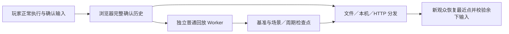

# TH01–04 浏览器 Replay 与检查点旁观移植交接

更新：2026-10-21。参考实现位于 `th05-coop-lab`。本文件描述当前浏览器方案；`REPLAY-IMPLEMENTATION.md` 后半部的游戏帧插桩、490 字节分面初始化及旧迁移步骤均为历史，不应作为新开发的默认路径。

TH01–04 后续实现的实际支持模式、使用方法与验收结果见 [实现与验收记录](../REPLAY-IMPLEMENTATION-TH01-04.md)。本文后续表格仍为移植前的设计参考，不代表最新实现状态。

结论：TH05 已具备可复用的浏览器录制、确认历史、独立副本检查点、文件／本机／HTTP 分发与播放器机制，可供 TH01–04 开发接入。各作的核心状态、输入、暂停和关卡语义仍须适配，并完成独立验收；不是复制文件后即已支持。TH05 本轮实测、修复和剩余验收范围见 [验收交接](REPLAY-ACCEPTANCE-2026-10-21.md)。

## 1. 必须保留的边界

- 正在游戏的 DOS 实例不增加 Replay 专用指令、OUT 标记、WASM 导入、专用核心或 MAIN／MAINE 覆盖。可以使用该项目本来就有的同步输入、普通运行核心和浏览器宿主接口。
- 生成检查点的是浏览器中的独立回放实例。它消费已经确认的输入，独立模拟、捕获、压缩；玩家不等待它、服务器、观众或文件保存。
- 只录制最终确认输入。存在待纠正预测时，即使收齐远端输入也不能发布。错误预测及其音效／音乐事件必须随恢复丢弃。
- 观众只操作播放器。剧情、原生菜单、续关、路线和暂停按已记录操作自动重演；不能要求观众补按剧情键来维持确定性。
- 完整状态与后续输入必须能在新实例上接续校验；只同步残机、Bomb、Power 和显示分数不成立。RNG、对象池、文件流、输入边沿等也影响未来。
- 辅助链路失败只停止自身。检查点失败可回退完整确认输入，实际输入或证明不一致仍须报错，禁止忽略校验继续。

浏览器 CPU、内存、压缩及传输有成本，独立 Worker 仍与游戏共享物理机器。这里承诺的是玩家 DOS 执行路径不新增录像逻辑，不是所有设备的墙钟 FPS 都不变。

## 2. 分清两条录制路径

| 路径 | TH05 当前实现 | 适用移植方向 |
| --- | --- | --- |
| 单人普通 JSPI 模拟器 | `.th05r`，`T05EXT02`／`th05-external-jspi/2`；记录浏览器时钟调用和输入交付边界，包含启动／菜单／剧情／暂停 | TH02–04 单人可研究复用；必须核对各自加载器和时钟调用，不能只记按键或 rAF 次数 |
| 多人确定步进 | `.th05m`，已确认输入历史＋可选可移植检查点；播放时不重放真人墙钟 | TH02–04 联机的主要参考；TH01 的确定性原生步进也可沿用历史／检查点架构 |
| TH01 原生 C++／WASM 单人 | TH05 没有替它实现录制器 | 单独记录该原生核心实际消费的确定性步骤和浏览器命令；不要套用 DOSBox 的 FS／续体或 TH05 的时钟胶水 |

TH05 单人时钟文件目前没有多人检查点式定位。旧 `T05FRM03` 只保留历史播放入口，不能作为满足上述约束的录制模板。单人与多人文件、不同作品及不同适配器身份不得混用。

## 3. 当前参考模块与复用程度

以下路径均相对本目录。

| 模块 | 作用 | 移植要求 |
| --- | --- | --- |
| `web/external-replay-host.js` | 普通加载器的宿主时钟与输入交付；录制停止后继续普通调度 | 校验目标加载器；不能将 TH05 的替换位置用于不匹配的胶水 |
| `web/browser-replay-recorder.js`、`external-replay-codec.js`、`external-replay-store*.js` | 单人生命周期、身份、时钟／命令分区、异步 gzip、有界积压 | 更换作品身份、格式命名、输入命令及最终状态证明 |
| `web/netplay/confirmed-history.js` | 连续、不可替换的确认行；输入／离线／作弊校验 | TH05 行宽为 `players*8+13`，输入为 44 位安全整数；各作必须定义自己的 schema |
| `web/checkpoint-builder.js` | 独立普通旁观 Worker；串行推进、基准／换面／周期／尾点生成 | 更换启动、命令、证明与场景识别适配；不在玩家核心中调用 capture |
| `web/portable-checkpoint.js` | DOSBox 全状态图与字节缓冲捕获、基准 XOR／gzip、恢复 | 只对匹配胶水和已导出核心状态成立；TH01 需另写 serializer |
| `web/netplay/checkpoint-archive.js` | 点的顺序、SHA、容量与索引 | 结构可复用；帧上限、场景键和容量不能照搬 |
| `web/netplay/history-host.js` | 录制、途中导出、独立生成器、本机订阅与网络发布的生命周期 | 保留确认门、异步故障隔离和有界订阅；换接各作会话结束事件 |
| `web/netplay/history-codec.js` | gzip 输入与检查点分区，外层及单点完整性校验 | 更换作品 magic／version；输入和状态协议显式版本化 |
| `web/netplay/history-network.js`、`lan_history.py`、`lan_server.py` | 认证发布、只读旁观、分块上传／下载、重试及内存归档 | 适配各作房间／席位／代次认证，保持观众不占玩家席位 |
| `web/coop-replay.js`／`.html` | 定位、选面、Live、暂停、取消、声音恢复、EOF 与降级 | 保留实例代次和取消语义；替换核心命令、场景标签、节拍及证明 |
| `web/netplay/history-identity.js` | 资源及影响重演的浏览器源码指纹 | 为目标作重建完整身份，不移除不匹配检查来兼容旧文件 |

`patch-stage-*`、`th05-stage-*`、`wdosbox-x-stage*` 和旧 `stage-load` 分面重建不属于可复用的正式方案。它们有已知长前史失配且要求专用资源；无需构建或开放它们来实现浏览器检查点。

## 4. 数据流与适配器契约



没有从检查点生成器或观众返回玩家执行屏障的依赖。服务器只存储和分发，不运行游戏。

先为每作定义下列语义，再改接参考实现；下列为契约，不是当前已有的通用 SDK：

```text
boot(config, resources) -> identity, openingProof
appendConfirmed(first, rows)  # first 必须等于已保留帧数
advanceVerified(frame, rows<=sliceLimit) -> applied, nextFrame, proof, sceneKey
capturePortable() -> bytes    # 只在独立副本的已确认边界
restorePortable(baseBytes, pointBytes) -> nextFrame, proof, audioState
end(nextFrame, reason)        # 意外中断是片段结束，不伪称通关
stop()                       # 终止旧副本和过期请求
```

TH05 的帧 `F` 表示 `[0,F)` 输入已执行，恢复后下一行是 `F`；恢复证明与历史 `row(F-1)` 对齐。`frame==confirmed`、效果已消费、没有活动预测恢复窗口时才能捕获。`history-slice` 对每个已执行同步步校验，而非只看批尾。

TH05 启动先保存帧零基准，此后换面观测后的批尾、固定每 1800 同步帧、结束尾部保存。当前一个批次最多 32 步，约 16 ms 后不开始下一步；单步可能超过 16 ms。换面点可能晚于真实换面，属于完整状态续播点，不是原生第一条关卡指令。

周期须由各作同步节拍换算。TH01 当前 `TICK=1000*440/24830`，约 56.4 步／秒，1800 步不是 30 秒；不可将 TH05 的 60 Hz 调度和周期常量直接复制。

场景索引建议用 `{run, route, stage, round, visit}` 等作品实际语义。TH05 目前的第 2–6 面数字列表不能直接覆盖 TH01 两条路线、重复续关或 TH03 对局／回合。

## 5. 状态捕获与恢复要求

DOSBox 参考实现捕获：WASM 整堆、`__rollback_g*` 可变全局、挂起续体的数值状态、MEMFS 文件／目录／挂载／流／TTY 图、键矩阵、画面，以及宿主 frame、时钟、输入边沿、暂停、邮箱定位、触控及音乐状态。未知宿主函数／原型失败退出，不在文件中保存或执行闭包源码。新实例使用自身可信唤醒闭包。

每个差分点对帧零基准的等长字节缓冲作 XOR 后 gzip；恢复只需共用基准＋目标点，不需串行应用所有旧点。不同形状的缓冲保存全量字节。目标堆长度、资源及适配器必须匹配；目前不是能跨 WASM 构建、内存布局、浏览器胶水任意恢复的通用存档。

移植前逐项确认：

1. 现有普通核心已提供完整恢复所需状态访问；不能为录像给玩家换插桩核心。若存在不可访问的可变原生全局或隐藏宿主状态，先报告能力缺口，不把“只复制 HEAP”冒充完整恢复。
2. 宿主运行状态有显式 capture／restore；Set／Map、类实例、函数闭包不能直接 JSON 序列化。TH05 的 FS 图编码也不能当作任意 JS 对象序列化器。
3. 文件对象引用、打开位置、挂载、句柄和缓冲别名需要正确保留；目标实现必须用实际加载／写入后的新实例恢复验证。当前 serializer 不宣称支持任意共享 TypedArray 视图图。
4. 暂停请求的按下／释放边沿、累计帧和输入消费游标必须继承；不能仅恢复画面、坐标或玩家资源。
5. 恢复后先比较该历史边界证明，再推进余下输入；后续每步继续比较。周期全状态证明也保留，不能为了跳转去掉 RNG／对象池等字段。
6. 声音使用恢复后的音乐命令状态；快进不播放过时音效，回退清空音效去重／时间线。暂停恢复保持音频 suspended，继续时才播放。
7. 生成副本不得写入玩家排行榜、浏览器存档或网络房间控制；文件副作用只发生在隔离虚拟机内。TH01 当前运行适配器会更新本机成绩存储，复制它作副本时必须隔离这条副作用。

## 6. TH01／02／03／04 的接入点

下列是对当前本地工作区源码的静态确认，不表示这些项目已接入 Replay 或通过功能测试。

| 作品 | 当前实现及应读文件 | 必须单独完成的适配 |
| --- | --- | --- |
| TH01 | `../th01-multiorb-lab/src/core.h`；`web/netplay/runtime.js`、`queue.js`、`session.js`。原生 C++／WASM、固定 4 MiB 内存、无 WASM 外部导入；协议 `th01-native-lockstep/1` | 以 `GameRuntime.step` 消费后的锁步行录制，保存 frame／previous／hostSlot／配置／同步菜单和成绩状态。使用现有 `th_net_checksum` 并核对全部可变 WASM 状态。`th_render_snapshot_info` 明确仅用于绘图，不能作为模拟检查点。路线、开球、过关确认、续关和结局命令要随历史重演 |
| TH02 | `../th02-coop-lab/web/netplay/runtime.js`、`runtime-worker.js`、`rollback-queue.js`、`../dosbox-snapshots.js`；协议 `th02-rollback/6` | 从纠正后的 confirm 前缀发布，保留 touch、offlineMask、暂停输入与音乐游标。现有 capture／restore 是本实例的短窗回滚，不是可移植字节。单人 JSPI 与联机 Asyncify 分别适配；关卡／Extra／结局程序不能使用 TH05 地址和编号 |
| TH03 | `../th03-netplay-lab/web/netplay/simulation.js`、`simulation-worker.js`、`frame-controls.js`；`input-policy.js` 协议 `th03-rollback/6` | 输入含 `commands`、`actions`、`touch`，不能压成 TH05 按键整数。保存 pauseSeat、selection、hidden 集合、NativePause、controls、music 与音频确认状态。以对局／回合／角色选择阶段组织索引，覆盖原生认输、重赛、暂停及前后台命令 |
| TH04 | `../th04-coop-lab/web/netplay/runtime.js`、`runtime-worker.js`、`rollback-queue.js`、`../dosbox-snapshots.js`；协议 `th04-rollback/4` | 继承 pauseMenu 的 previous／paused／selection／exited，以及 blocked、emulatedTicks、输入锁存、邮箱与音乐。Worker 外层 SE sequence／去重状态也须处理。周期音效桥与三人输入保持原语义，不替换其已有射弹分色／性能核心 |

表中 `web/...` 是相应项目内路径。TH02／04 的 Worker 命令使用串行 RPC，TH03 使用 `method/args`；不要直接给它们发送 TH05 的消息名。各作现有回滚快照只能指导状态清单，不能直接通过 postMessage 传函数引用给新观众。

## 7. 文件、传输与容量

TH05 多人容器：前 8 字节 magic＋4 字节小端 JSON 长度＋JSON＋载荷。纯输入 `T05MP001`；历史插桩分面 `T05MP002`；携带浏览器检查点 `T05MP003`。三代容器包含输入 gzip、可选历史分区及检查点字节。`syncPayloadBytes`／`stagePayloadBytes` 划分，`checkpointIndex` 包含 `frame, stage, sha, offset, size`。外层载荷 SHA 及每点 SHA 均验证，偏移连续且不能越界。

HTTP 发布带房主 token／room／generation，观众仅持只读 watch capability；不得把玩家 token 填入分享链接。确认输入上传优先，每次最多 60 行；读取最多 300 行。检查点 POST `/api/history-checkpoint` 以 `frame,stage,sha,size,offset,payload` 分块，`payload` 为 base64，每块最多 32768 原始字节；结束采点以 `done:true` 通知。GET 同一路径以 `watch,frame,offset` 下载，响应包含同一元数据及分块内容。只有完整且 SHA 正确的点才进入索引，丢 ACK 的相同重传不能重复追加。

结束输入可以先发 EOF，再继续上传最后检查点。观众接收 EOF 后仍能取后续索引及既有点；本机订阅结束后也须保留按需点读取，直到退订或来源关闭。服务器仅内存保存，读者不刷新归档活动期限。

| TH05 当前限制 | 数值／行为 |
| --- | --- |
| 历史 | 每段 216000 同步步；最多 16 段；发布者不活动 900 秒清理 |
| 点数与压缩字节 | 每局最多 128 点、合计 128 MiB、单点 16 MiB；服务检查点总预留 256 MiB |
| 解压 | 每点原始 192 MiB、JSON 8 MiB；多人文件载荷 160 MiB |
| 本机订阅 | 最多 8 个；每人最多一批未 ACK 的 60 行；15 秒无进展退役该观众 |
| HTTP | 请求体 64 KiB；点分块 32 KiB 原始字节；输入未上传积压超过 3600 帧只退役网络发布器 |
| 压缩 | 未消费积压最多 256 KiB／128 批，15 秒无确认进展停止该录制器 |
| 导出 | 途中固定前缀及当时已有点；结束封存最多等生成器 30 秒，可导出部分点 |

新观众仍需接收完整输入历史；优化的是模拟执行前缀，不是只下载当前面或视频流。首次基准约数 MB，后续差分大小由场景决定。没有点、生成／上传没追上、超限后的区间或恢复失败时，完整历史执行仍可能较慢。TH05 数值是实现限制，不是四作的统一承诺；作品协议需明确自己的限制及超限语义。

## 8. 推荐开发与验收顺序

1. 固定该作品的普通核心、磁盘和输入协议；保存摘要及现有无录像运行对照。
2. 定义输入／浏览器控制命令 schema、同步帧语义和确认发布门。先做完整历史导出、新实例从头重演、终点证明一致。
3. 接独立副本，确认玩家与副本不互等；副本失败、压缩失败、观众慢、上传断网时玩家继续。
4. 先做帧零完整状态和任意较晚帧的跨实例恢复。此阶段不用差分或选面掩盖状态缺失。
5. 增加基准差分、周期与场景检查点；保留完整输入作为回退。
6. 接文件、本机、HTTP 点索引及按需获取；新 context 晚加入必须真正使用来源点，不能拿观众先前看过的缓存作证。
7. 接播放器选段、前后定位、Live、暂停、取消／替换目标、声音和精确 EOF。异步启动、下载与 Worker 回复都受实例代次隔离。
8. 最后运行完整自然流程、真实设备和异地长局；记录逻辑步率、原生计数、绘制率与墙钟延迟，分别陈述结果。

以下为每作移植验收门，不能用 TH05 的 PASS 代替：

| 验收门 | 必须保留的证据 |
| --- | --- |
| 玩家执行隔离 | 普通磁盘／WASM 摘要不变；正式页面无录像专用资源；录制开／关的相同输入产生相同状态；玩家拒绝旁观捕获／恢复命令 |
| 跨实例确定性 | 新实例恢复较晚点后至少 360 步逐步证明一致，包含长前缀、文件加载后、暂停／菜单和输入边沿 |
| 场景切换 | 实际原生加载后采点、选面／选回合成功、恢复后战斗继续；QA 触发与自然通过分别标记 |
| 长历史 | 目标 T 使用检查点 C，执行量为 T-C；记录 C、T、实际执行步数与耗时，不能只看 UI 跳到了目标 |
| 网络 | 独立 context 晚加入；丢输入 ACK、丢点 ACK、读超时／503、重试幂等、半点不可见、权限及过期拒绝 |
| 生命周期 | 途中导出后玩家继续；结束／退出生成可验证片段；启动中取消、替换目标、暂停到最终点仍正确显示 EOF |
| 声音与控制 | 恢复音乐／音效时间线；暂停不发声；观众操作不入游戏；剧情／菜单无需观众补操作 |
| 降级与容量 | 压缩／生成器故障、坏点、缺基准、错身份、容量和积压上限；不影响玩家且不忽略模拟不一致 |
| 产品流程 | 单人、多人数、语言、回滚设置、普通触控及作弊政策；完整自然通关／跨段、真实浏览器与设备 |

## 9. TH05 复验命令和交付边界

在 `th05-coop-lab` 工作目录运行；浏览器脚本当前使用本机 Playwright 模块及 Edge 路径，移植测试机应先替换／参数化这些路径。测试通过资源路由和 Python stdio 调用真实 Handler，不启动监听服务。每个带环境变量的组合在新 PowerShell 中执行，避免夹具变量互相污染。

```powershell
node tools/test_checkpoint_builder.mjs
node tools/test_confirmed_history.mjs
python tools/test_history_service.py
node tools/test_checkpoint_history.cjs
$env:TH05_CHECKPOINT_STAGE='1'; node tools/test_checkpoint_history.cjs
$env:TH05_PREFIX='6000'; node tools/test_portable_checkpoint.cjs
$env:TH05_LANGUAGE='jp'; $env:TH05_PREFIX='1800'; node tools/test_portable_checkpoint.cjs
node tools/test_replay_seek.cjs
node tools/test_network_history.cjs
node tools/test_multiplayer_history.cjs
node tools/test_browser_replay.cjs
$env:TH05_LANGUAGE='jp'; $env:TH05_RECORD_QUIT='1'; node tools/test_browser_replay.cjs
$env:TH05_RECORD_FAULT='1'; node tools/test_browser_replay.cjs
node tools/test_browser_replay_host.mjs
node tools/test_external_replay_codec.mjs
node tools/test_replay_browser_policy.cjs
node tools/test_legacy_browser_playback.cjs
```

换面 QA 通过测试路由给 Worker 附加原生加载请求，该源码也参与资源身份。因此 `checkpoint-stage-history.th05m` 必须使用同一测试路由复验；正式播放器拒绝其测试身份是预期行为。普通 `checkpoint-history.th05m` 没有这段换面夹具。

TH05 的报告留在本地 `reports/`，默认不随发行仓库发布。交给外部开发时同时提供验收交接、对应报告和所测源码／资源摘要；只给旧实验说明或测试截图不足以复现。TH01–04 本轮只做静态接入点检查，没有修改它们的代码或部署，也没有宣称它们已实现此功能。
